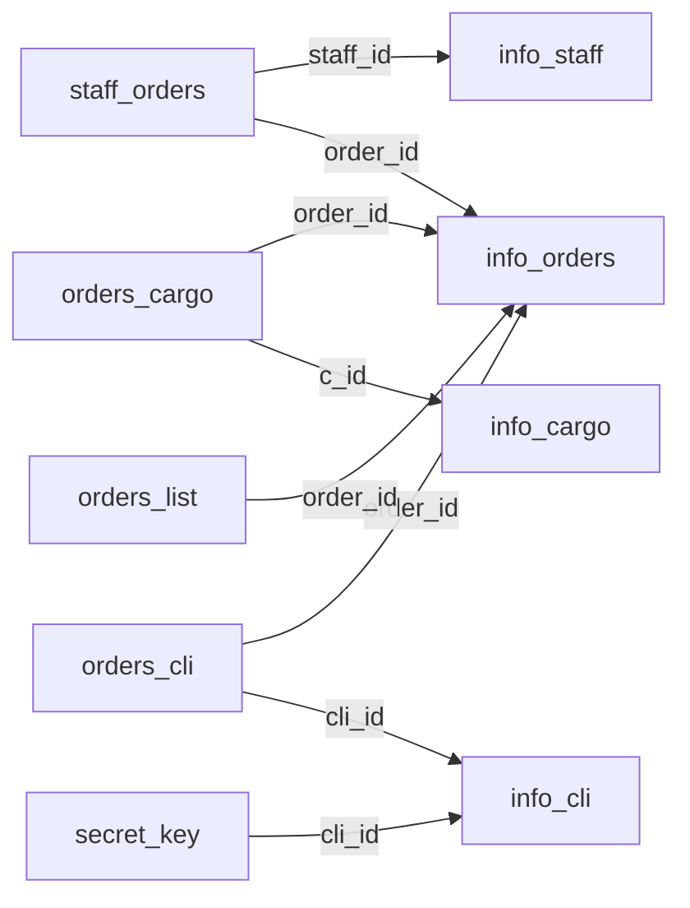

# Submitted database schema

This guide describes the checked-in PostgreSQL dump, rather than an idealized
logistics schema. The archive contains 11 tables in `public`. The restored snapshot contains
200,000 staging rows, 20,010 order records, 17,712 cargo records, 50 clients,
and 10 staff records. The inspection below found no NULLs in the eight declared
relationship columns; the schema still permits them.

## Tables

| Table | Primary key | Main fields and role |
| --- | --- | --- |
| `info_staff` | `staff_id` | Staff age, language, first and last names |
| `info_orders` | `order_id` | Original `order_pk`, delivery address/country, company, price and timestamp |
| `info_cli` | `cli_id` | Client email, phone, secret, first and last names |
| `info_cargo` | `c_id` | Cargo PIN, token, generation and type |
| `staff_orders` | None | Staff-to-order association |
| `orders_cargo` | None | Order-to-cargo association; also retains `c_token` |
| `orders_cli` | None | Order/client association with address and PIN |
| `orders_list` | None | Order/item-list text fragments |
| `secret_key` | None | Client-linked secret, cargo token and PIN |
| `sample`, `sample_02` | None | Intermediate copies of the flat input |

## Declared foreign keys

Each arrow points from a referencing table to its referenced entity table. The
foreign-key columns are nullable; the diagram does not imply a required link.



`orders_list.order_list` is text; it has no foreign key to `info_cargo`.
`orders_cargo.c_token` and `secret_key.c_token` are also not foreign keys.

## Inspect the result

Run the read-only inspection from the repository root after restoring the dump:

```sh
psql --dbname=logistics_course --set=ON_ERROR_STOP=1 --file=scripts/inspect.sql
```

It reports row counts, actual primary/foreign-key definitions, and missing
relationship links without modifying tables. A declared foreign key validates
non-NULL references; it does not prevent missing links or duplicate association
rows when no unique constraint exists.

For example, inspect orders and their assigned staff:

```sql
SELECT o.order_id, o.order_pk, count(DISTINCT so.staff_id) AS assigned_staff
FROM public.info_orders AS o
LEFT JOIN public.staff_orders AS so ON so.order_id = o.order_id
GROUP BY o.order_id, o.order_pk
ORDER BY o.order_id
LIMIT 20;
```

## Design observations

- The CSV's missing values were filled using interactive heuristics. Matching
  a name, address or country does not prove that records represent one entity.
- Association/detail tables have no primary or unique keys. Duplicate rows
  remain possible, and nullable references do not guarantee complete mappings.
- `order_price` uses `real`; an exact monetary representation would need a
  deliberate migration. `c_pin` uses integer, which loses leading zeros.
- Names were split at the first/last token, so the result does not preserve every
  possible multi-part name.
- Credentials and contact-like fields belong to the exercise's input model;
  the repository does not implement authentication or access control.

These observations explain the limits of the historical snapshot. They are not
changes to the submitted data or a claim that a replacement schema has been
validated.
